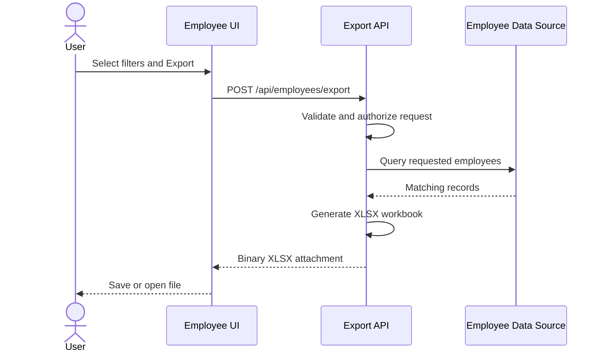

# Worked example: Employee XLSX Export API

**Author:** Sergei Budnik  
**Basis:** `API_EXAMPLE.docx` in the author's source library.  
**Status:** illustrative public technical example. This page focuses on the export endpoint; the source document also contains a separate bulk-update endpoint.

## Objective

Allow an authorized client to export employees to an XLSX file, optionally filtered by employee fields or limited to a selected set of employees.

## Interface

| Property | Value |
|---|---|
| Method | `POST` |
| Endpoint | `/api/employees/export` |
| Request media type | `application/json` |
| Response media type | `application/vnd.openxmlformats-officedocument.spreadsheetml.sheet` |
| Response | Binary XLSX attachment |

## Supported behavior

1. A client may filter records by fields, including salary range.
2. A client may pass `selectedEmployeeIds` to export selected rows.
3. With normal pagination, `pagination.page` and `pagination.pageSize` are required.
4. With `all: true`, pagination may be omitted; filters and selection may still apply.
5. Salary filter values may be integer or fractional numeric values.

## Sample requests

### Page-based export
```json
{
  "pagination": {"page": 1, "pageSize": 10}
}
```

### Selected employees, no pagination
```json
{
  "all": true,
  "selectedEmployeeIds": ["EMP-1001", "EMP-1002"]
}
```

### Salary range (illustrative selection)
```json
{
  "all": true,
  "filter": {"salaryMin": 40000, "salaryMax": 100000}
}
```

> Fields and values in these examples should be reconciled with the project's actual API schema before implementation. Employee IDs and salaries are synthetic.

## Response headers

```http
Content-Type: application/vnd.openxmlformats-officedocument.spreadsheetml.sheet
Content-Disposition: attachment; filename="employees_export.xlsx"
```

The response body is binary, not JSON. A client should handle file download appropriately.

## Processing sequence



The sequence is a **supplemental explanatory diagram**, not an exact implementation diagram included in the source document.

## Review questions before production

- What authorization scope is needed for employee and salary data?
- Is the `all: true` export limited to a maximum dataset size?
- How are empty results, invalid filters, and errors represented?
- Should large exports use asynchronous report generation rather than a synchronous HTTP response?
- What logging, audit and retention controls apply to sensitive exports?

These questions are **engineering recommendations**, not confirmed requirements from the source example.

**Related:** [Integration specification](../templates/integration-specification.md) · [Sequence diagram guide](../templates/sequence-diagram-guide.md).