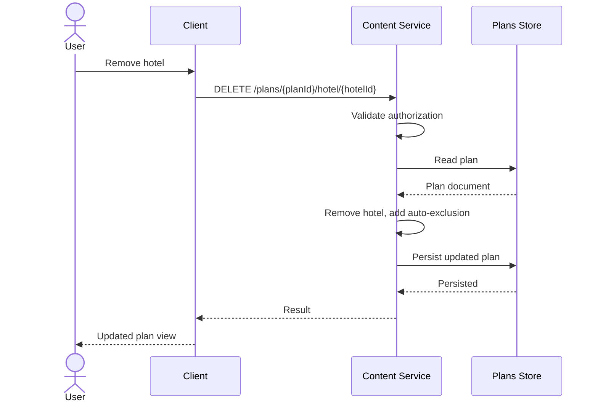

# Worked example: remove a hotel from a travel plan

**Author:** Sergei Budnik  
**Basis:** authored `BACK_SRS_EXAMPLE_1.docx`, library v1.0.0 (2025-09-04).  
**Status:** educational example. Identifiers and storage names below follow the original sample's terminology; do not assume they apply to another application.

## API operation

```http
DELETE /content/v1/plans/{planId}/hotel/{hotelId}
```

**Business objective:** Remove a specified hotel from an existing travel plan and prevent the same hotel being added again automatically to that plan.

## Request contract

| Field | Location | Mandatory | Meaning |
|---|---|---|---|
| `rqid` | HTTP header | Yes | Request correlation identifier, GUID |
| `Authorization` | HTTP header | Yes | User authorization token |
| `planId` | Path | Yes | Travel plan identifier |
| `hotelId` | Path | Yes | Hotel identifier in the CMS |

## Persistence model from the sample

| Collection / field | Meaning |
|---|---|
| `plans._id` | Plan identifier |
| `plans.cmsEntityList[]` | Entity list including hotels |
| `plans.days[].planDayEntityList[]` | Entities allocated to plan days |
| `plans.cmsNoAutoList[]` | Entity exclusions from future automatic addition |
| `plans.updateDate` | Plan modification timestamp |

## Main processing flow

1. Validate token and ensure the requesting user is authorized for `planId`.
2. Read the specified plan from the persistence layer.
3. Identify entries for `hotelId` with `type = HOTEL`.
4. Remove matching entries from the plan-level `cmsEntityList` and from daily `planDayEntityList` arrays.
5. Adjust subsequent day-list positioning as required by the plan ordering rules.
6. If the ID is not already in `cmsNoAutoList`, append the exclusion.
7. Update `plans.updateDate`.
8. Return a synchronous result and log errors according to the service contract.

**Important:** The source document specifies more detailed behavior for absence of the hotel and error formation. This public condensed example is not a substitute for the full reviewed specification.

## Illustrative sequence



## Error conditions to document

| Case | Expected handling to specify |
|---|---|
| Unauthorized access | Reject before modifying plan |
| Plan not found | Stable not-found error contract |
| Hotel not in plan | Define explicit no-op / error behavior |
| Store update fails | Ensure atomic state and explain retry |
| Duplicate deletion request | Ensure repeated invocation cannot corrupt arrays |

These last recommendations are implementation review prompts. The source's exact codes and error rules must be checked before reuse in production.

**Related:** [Backend SRS template](../templates/backend-srs-template.md) · [Sequence diagram guide](../templates/sequence-diagram-guide.md).