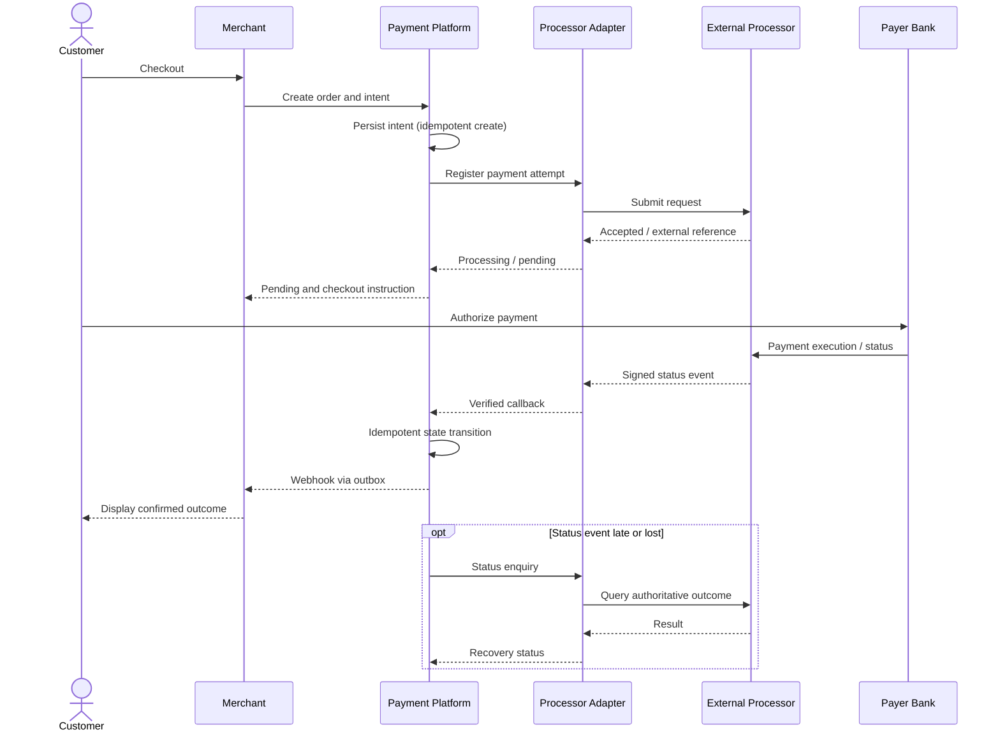

# End-to-end payment flow: orchestration and processing

This **fictional** A2A merchant payment reference follows architectural themes in Sergei Budnik's authored RoPay reference diagrams but uses only generic roles, endpoints and assumptions. No participant-specific requirements are asserted.

## HLD components

| Component | Core responsibility | Critical dependency |
|---|---|---|
| Merchant checkout | Create order, show payment options, receive final notification | Payment platform |
| API gateway | Authentication, request validation, throttling and correlation | Identity/policy |
| Payment orchestrator | Own intent and attempt lifecycle; coordinate downstream requests | Processor adapter, state store |
| Processor / bank adapter | Translate internal contract to provider messages | External processor |
| Payment network / bank | Authorize, route and execute according to rail-specific rules | External participants |
| Callback receiver | Verify provider events, deduplicate and update state | Event inbox, state store |
| Recovery worker | Resolve ambiguous or stale attempts via authoritative status inquiry | Provider status API |
| Merchant notifier | Deliver outcomes to merchant idempotently | Webhook outbox |
| Reconciliation | Compare internal records against external reports/events | Ledger and external statements |

## Main flow

1. Merchant creates an order and requests a payment intent with a unique merchant reference.
2. Platform validates request, creates intent and returns an opaque identifier.
3. Orchestrator creates a **payment attempt**; adapter registers it with the chosen processing provider.
4. Customer authorizes through their bank/channel; the processor or payment network advances processing.
5. Verified status events are consumed through an **idempotent callback handler**.
6. Payment attempt reaches a known result; order state is updated according to business rules.
7. Merchant webhook delivery uses an outbox and retries independently of the payment instruction.
8. A reconciliation workflow checks for delayed or inconsistent external outcomes.

## Illustrative sequence

For a downloadable editable HLD, see [PlantUML sources](diagrams.md).

## Architecture decisions

| Decision | Recommendation | Why |
|---|---|---|
| Intent vs order | Separate aggregates linked by identifiers | One order can have retries / multiple attempts |
| External identifiers | Persist provider reference with mapping | Traceability and status lookup |
| Callback authentication | Verify signatures, timestamp and provider identity | Do not trust unsolicited state changes |
| Message delivery | Durable outbox for merchant events | Prevent lost notifications |
| Recovery | Authoritative status enquiry before financial replay | Avoid duplicate payments |
| Financial accounting | Use an appropriate append-only ledger / reconciliation | Preserve auditable money movement |

## Checklist

- [ ] Boundaries between merchant, platform, processor and bank are explicit
- [ ] External timeout has an **UNKNOWN/PENDING** representation
- [ ] Callback can arrive late, twice or out of order
- [ ] Merchant notification failure does not change payment outcome
- [ ] Reconciliation can explain divergence between internal and external data
- [ ] PII and financial secrets are absent from logs