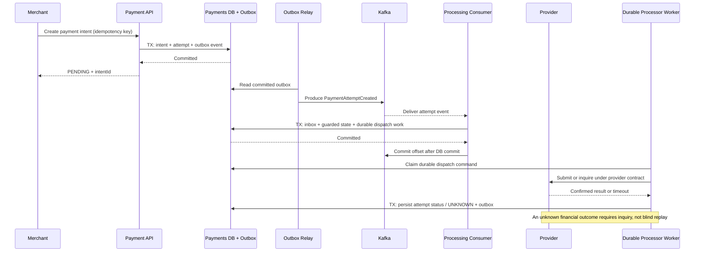

# Event-Driven Payment Processing with Kafka

**Author:** Sergei Budnik · **Release:** October 2026  
**Type:** New, fictional and provider-neutral architecture reference. The Kafka topics, API contracts, component names and operational thresholds are illustrative design choices—not configuration from any bank, fintech client, or card scheme.

## 1. Architecture problem

A payment platform must reliably process provider callbacks, update payment states, notify merchants, and reconcile transactions even when services, databases and Kafka brokers are temporarily unavailable. A synchronous request alone cannot guarantee that a downstream event or merchant webhook is delivered.

This reference proposes an **event-driven payment processing architecture** using Kafka, a transactional outbox, an inbox/deduplication store, state-transition guards and recovery workers.

**Boundaries:** Kafka is a delivery and event-log component, **not the source of financial truth**. Provider-confirmed payment outcomes, governed ledger postings and reconciliation reports remain authoritative within their domains. An event named `PaymentSucceeded` is only trustworthy if the originating service already validated its source and applied the required transition.

## 2. Component model

| Component | Responsibility | Durable control |
|---|---|---|
| Merchant API | Authenticate request, require idempotency key, create payment intent | Request key scoped to merchant + operation |
| Payment Orchestrator | Own intent/attempt state and allowed transitions | Versioned transactional state store |
| Processor Adapter | Translate to provider-specific request/response; persist correlation | External reference and inquiry contract |
| Callback Ingress | Verify provider signatures/authenticity, record raw delivery safely | Unique external event key / inbound inbox |
| Payment State Service | Apply validated events to attempts and business effects | Inbox + state change in one DB transaction |
| Transactional Outbox | Store new domain events in same DB transaction as state change | Unique event ID and publication status |
| Outbox Relay / CDC | Publish committed outbox events to Kafka | At-least-once publication, monitoring |
| Kafka Broker | Durable transport with per-partition ordering and consumer groups | Replication, retention, ACLs, lag alerting |
| Merchant Notification Consumer | Create durable webhook delivery work | Consumer inbox + delivery outbox |
| Recovery Worker | Resolve UNKNOWN attempts through provider status enquiry | Bounded backoff, audit, operational escalation |
| Reconciliation | Match independent processor/bank reports to internal records | Match keys, exception cases and correction trail |
| Financial Ledger | Idempotent, auditable financial postings when relevant | Unique posting key, balanced entries |

## 3. Canonical event journey

1. Merchant initiates an intent with idempotency key; orchestrator stores intent, attempt and outbox event atomically.
2. Outbox relay publishes `PaymentAttemptCreated` to Kafka; messages may be **redelivered**.
3. Processing consumer deduplicates the event and **durably records dispatch work** in its database transaction, then commits its Kafka offset. A separately recoverable processor worker submits that work under a **provider-supported** idempotency/correlation contract; after an uncertain submission it inquires rather than blindly replaying.
4. Verified provider callback or status inquiry enters an inbox; state service applies an allowed transition (for example, `PROCESSING → SUCCEEDED`).
5. **In the same database transaction**, the state service records an outbox event such as `PaymentOutcomeConfirmed`.
6. Outbox relay publishes; notification consumer creates durable merchant delivery work; merchant webhook retries independently.
7. Reconciliation later matches external financial records; it is not replaced by a Kafka event.

> Critical external-call rule: **Never assume an outbound processor request is safe to replay just because Kafka redelivered a message.** If the first request's financial outcome is unknown, resolve it using authoritative provider inquiry/reconciliation or a provider-guaranteed replay contract.

## 4. Topic and partition proposal

| Topic (illustrative) | Message key | Consumer |
|---|---|---|
| `payments.attempt.created.v1` | `attemptId` | Processor worker |
| `payments.attempt.status.v1` | `attemptId` | Payment state consumer |
| `payments.outcome.confirmed.v1` | `intentId` | Merchant notification, audit projection |
| `payments.reconciliation.exception.v1` | `caseId` | Finance operations projection |
| `payments.attempt.status.retry.v1` | `attemptId` | Controlled retry worker |
| `payments.attempt.status.dlq.v1` | `attemptId` | Incident / reprocessing operators |

Kafka only guarantees ordering **within a partition**. Keying attempts by `attemptId` groups messages for a single attempt when the partitioner/partition count remain stable, but it does not guarantee global ordering or cross-topic ordering. Where payment-intent ordering is required, use `intentId` consistently in the relevant topic and define the ordering boundary.

Topic naming, partition count, replication and retention must be chosen according to throughput, recoverability, data classification and organizational convention.

## 5. Reliability decisions

| Risk | Architectural measure |
|---|---|
| DB transaction commits, producer crashes before Kafka publish | Transactional outbox + relay retries |
| Relay publishes, then crashes before marking outbox delivered | Repeated event possible; consumer inbox dedupes |
| Consumer crashes after DB commit, before offset commit | Replay same record; unique inbox key avoids duplicate business effect |
| Consumer acknowledges before DB commit | **Unsafe:** message may be lost as an effective business update |
| External payment instruction times out | UNKNOWN/PENDING + provider status enquiry; no blind financial replay |
| Two status sources race | Optimistic version/lock + authoritative transition policy |
| Consumer receives invalid payload | Bounded retries if transient, quarantine/DLQ for permanent failures |
| Webhook endpoint offline | Retry from durable merchant delivery queue, never repeat financial command |
| Kafka temporarily unavailable | Outbox retains events; backpressure, lag alerts and recovery procedures |
| Partition rebalanced while handler runs | Cooperative cancellation / fencing, durable dedupe, commit only owned offsets |

## 6. End-to-end processing diagram

The diagram focuses on a simplified initiation path; a real application must explicitly design atomic handoff and worker restart boundaries. The fuller editable PlantUML diagrams are linked below.

## 7. Editable PlantUML

- [Event-driven component HLD](https://github.com/SergeiBudnik/architecture-analysis-hub/blob/main/diagrams/event-driven-payment-hld.puml)
- [Transactional outbox + inbox sequence](https://github.com/SergeiBudnik/architecture-analysis-hub/blob/main/diagrams/event-driven-outbox-inbox-sequence.puml)
- [Kafka offset and crash recovery sequence](https://github.com/SergeiBudnik/architecture-analysis-hub/blob/main/diagrams/event-driven-offset-recovery-sequence.puml)
- [Retry / DLQ / manual redrive sequence](https://github.com/SergeiBudnik/architecture-analysis-hub/blob/main/diagrams/event-driven-dlq-recovery-sequence.puml)

## 8. Related documentation

- [Consumer offset crash walkthrough](kafka-offset-recovery.md)
- [Event contracts, SQL and pseudocode](event-driven-contracts.md)
- [Architecture decisions and validation tests](event-driven-design-decisions.md)
- [Payment idempotency and state machine](state-machine.md)
- [Provider timeout and recovery](reliability.md)
- [Clearing and reconciliation](clearing-settlement-reconciliation.md)

This is an educational system design, not a certified processor, Kafka benchmark or production guarantee.
