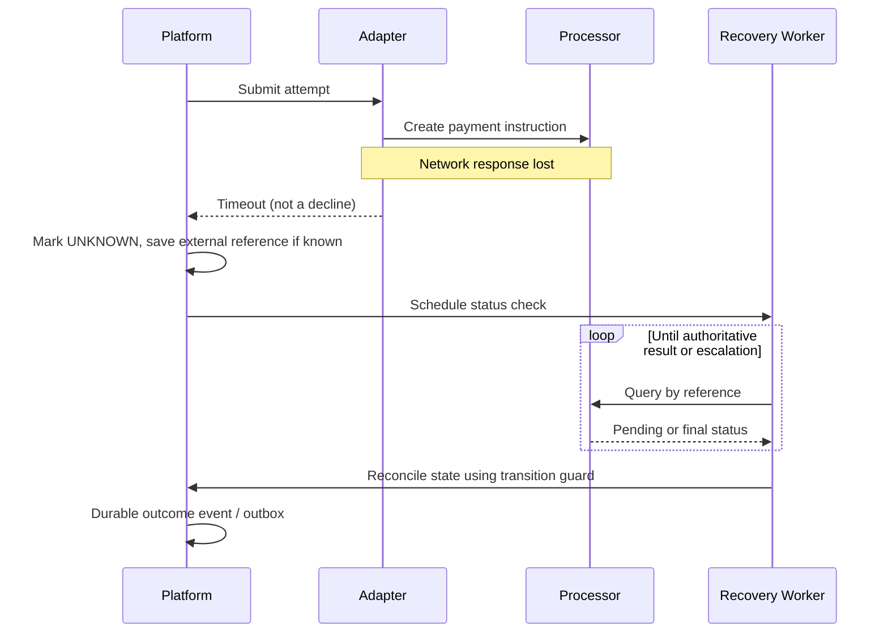

# Timeout, retry and recovery in payment processing

**Core principle:** *No response* and *negative response* are not equivalent.

## Failure classes

| Observation | Safe handling | Unsafe assumption |
|---|---|---|
| Validation rejected before processing | Correct request; submit a new valid request if appropriate | Treat validation rejection as payment success |
| Explicit final decline | Terminal failure for this attempt | Keep endlessly retrying same attempt |
| Network timeout after request sent | Mark attempt UNKNOWN / PENDING; query outcome | Automatically re-send financial instruction |
| Duplicate callback | Ack/dedupe, preserve terminal state | Repeat money movement or ledger posting |
| Merchant webhook failure | Retry **notification delivery** from outbox | Re-run payment |
| Processor outage | Circuit breaker / status recovery | Blind immediate replay |
| Eventual mismatch in reconciliation | Investigate and correct through governed process | Silently alter confirmed financial history |

## Recovery algorithm (educational pseudocode)

```text
on_submit_timeout(attempt):
    mark_unknown(attempt)
    enqueue_status_check(attempt.id)

status_worker(attempt):
    result = query_provider(attempt.external_reference)
    if result == CONFIRMED_SUCCESS:
        transition_if_allowed(attempt, SUCCEEDED)
    else if result == CONFIRMED_FAILURE:
        transition_if_allowed(attempt, FAILED)
    else:
        reschedule_with_backoff_and_jitter(attempt)
        alert_if_past_business_deadline(attempt)
```

Do **not** re-submit a financial instruction unless a specific provider contract guarantees replay semantics or the first instruction is authoritatively known not to have executed.

## Retry separation

1. **Transport retry**: potentially safe only for clearly idempotent operations or operations with an enforced idempotency key.
2. **Status enquiry retry**: generally the recovery path for unknown outcomes; apply rate limits and bounded backoff.
3. **Merchant webhook retry**: independent delivery, event ID dedupe, retry budget and dead-letter handling.
4. **Reconciliation retry**: separate asynchronous workflow with appropriate audit trail.

## End-to-end recovery sequence



## Observability fields

Track `intent_id`, `attempt_id`, `merchant_order_id`, `external_reference`, `correlation_id`, processing timestamps, state version, recovery-attempt count and last authoritative status.

Never log full card details, banking credentials, account secrets or private tokens.

## Review questions

- Is outcome inquiry available independently of callback delivery?
- Can callback and polling race safely without duplicate postings?
- Can reconciliation detect late success after local expiry?
- Is each terminal transition auditable, and is repair explicitly governed?
- Are exact retry budgets, timeouts and alerts documented per dependency?