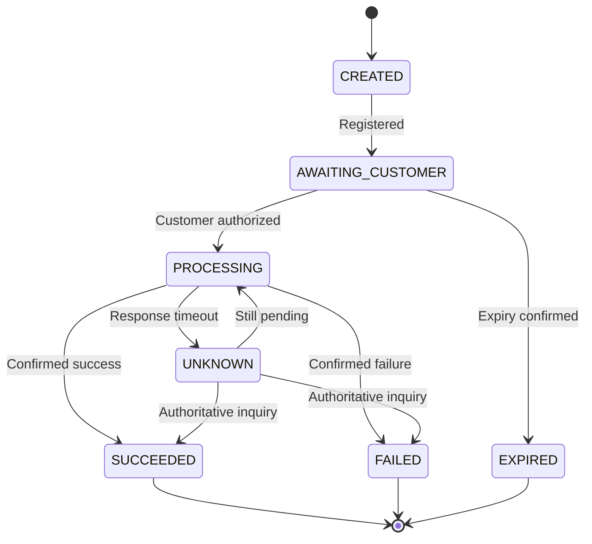

# Payment state machine and idempotency

**Synthetic reference model:** exact state names vary by scheme and processor. The model separates a payment intent from individual attempts.

## Intent lifecycle



**Guardrail:** A local expiry or timeout does not automatically justify marking the underlying financial transfer as failed. A provider can report a late success; scheme-specific acceptance and reconciliation rules govern the resolution.

## Entities

| Entity | Example ID | Invariant |
|---|---|---|
| Merchant Order | order-100 | Merchant commercial obligation |
| Payment Intent | pi-100 | One intended payment objective |
| Payment Attempt | pa-101 | One downstream submission and provider reference |
| Incoming Event | evt-102 | Unique provider event / delivery |
| Financial Ledger Entry | le-103 | Independently auditable posting |

## Idempotency for request initiation

Suggested request header:

```http
Idempotency-Key: 6bcb6be1-718f-4a49-ae05-f942bead410e
```

**Server-side sequence:**

1. Authenticate merchant and compute a normalized fingerprint of the submitted request.
2. Persist unique key scoped to merchant + operation; enforce a database unique constraint.
3. If an existing key has the **same payload**, return the stored result or current operation status.
4. If it has a **different payload**, reject it as an idempotency conflict.
5. Serialize concurrent requests so no second downstream instruction is accidentally generated.
6. Define retention based on business and network replay windows; do not choose a universal TTL without context.

## Inbound callback idempotency

Use an inbox/deduplication record with a unique event ID or an appropriate provider-specific compound key. Validate authenticity, correlate attempt, and apply only a permitted state transition. **Duplicates must not duplicate ledger postings or merchant notifications.**

## Illustrative persistence tables

```sql
CREATE TABLE payment_intent (
  intent_id VARCHAR(64) PRIMARY KEY,
  merchant_id VARCHAR(64) NOT NULL,
  merchant_order_id VARCHAR(64) NOT NULL,
  status VARCHAR(32) NOT NULL,
  version BIGINT NOT NULL DEFAULT 0
);
CREATE TABLE payment_idempotency (
  merchant_id VARCHAR(64) NOT NULL,
  operation VARCHAR(64) NOT NULL,
  idem_key VARCHAR(128) NOT NULL,
  request_fingerprint VARCHAR(128) NOT NULL,
  intent_id VARCHAR(64) NOT NULL,
  PRIMARY KEY (merchant_id, operation, idem_key)
);
```

Tables are intentionally simplified: add appropriate constraints, audit metadata, transactions, encryption and retention controls for production.

**Related:** [End-to-end processing](end-to-end.md) and [Reliability patterns](reliability.md).