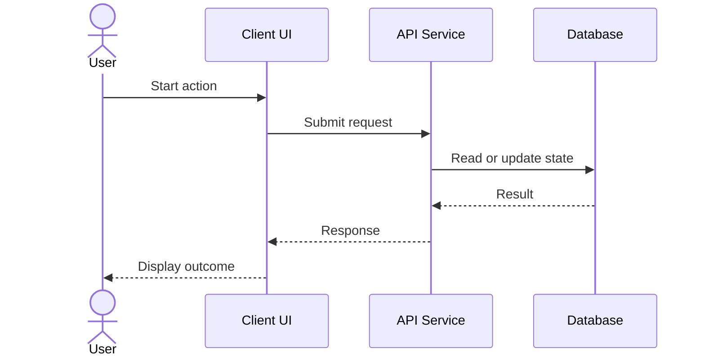

# Sequence Diagram Guide

*Adapted from Sergei Budnik's authored source library, `SEQUENCE_FAQ.docx` (v1.0.0, September 2025). This is a public Markdown adaptation; placeholder fields and technical example values are illustrative.*

## Purpose
A UML sequence diagram shows interactions between participants **over time**. Participants are represented by lifelines; messages are drawn between them in chronological order.

## Scenario inventory
| Element | Description |
|---|---|
| Actor | [User or external initiator] |
| Participants | [Components or services] |
| Trigger | [Starting event] |
| Main flow | [Ordered exchanges] |
| Alternatives | [Timeout, error, cancellation] |
| Result | [Final state] |

## Worked skeleton

## Review questions
- Are the lifelines and initiating actor explicit?
- Does each message have a meaningful business or technical label?
- Are important asynchronous exchanges distinguishable?
- Are alternatives and failures described?
- Does the diagram align with API and backend specifications?
